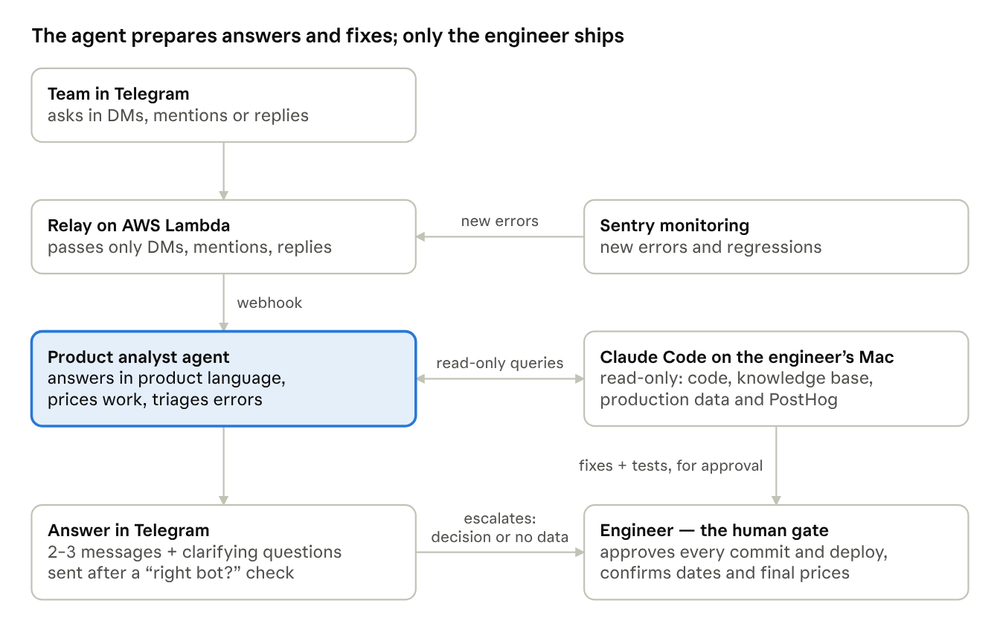

# Case study: an AI product analyst embedded in a client team

Andrey Bolshakov · November 2026

## Context

I deployed an AI agent that acts as a product analyst for a client's team, so they get answers about their own product without waiting for the engineer. The client runs an online course platform: a web app plus a mini-app inside two messengers. I am its sole engineer — I built the platform from scratch with AI coding agents and run it in production.

The problem was a bottleneck, and it was me. The product team asked a steady stream of questions: how a rule works, what a change would cost, whether an error in monitoring matters, what the numbers were last month. Every answer needed someone who could read the code and query production, so every question interrupted engineering work.

## What the agent does

The agent works as a digital product manager and analyst: it prepares answers and drafts, and the engineer makes every decision. The team talks to it in Telegram; I use the same agent for strategy and roadmap work.

| Job | What the team gets | What stays with the engineer |
| --- | --- | --- |
| Product questions | How a feature works, explained in product language, never as code | Anything that needs a decision |
| Production numbers | Real figures from read-only queries, never estimated | Access to anything beyond read-only |
| Change estimates | A breakdown in function points at fixed rates, plus clarifying questions | Calendar dates and the final quote |
| Error triage | Each new monitoring error classed as bug, feature request or noise | Approving every fix and deploy |
| Documents | Specs and notes filed in one shared Drive folder | — |

## Architecture

The agent never holds the code: it asks Claude Code, which runs read-only on my machine, and rewrites the technical answer in product terms. Errors from Sentry enter through the same relay, and anything that needs a decision or lacks data goes to me instead of being guessed.

## Guardrails

The safety rules were written into the agent's instructions before the team got access, and they outrank convenience. Each one closes a specific failure mode.

1. **Every commit and deploy needs the engineer's explicit yes.** The agent can prepare a fix; it cannot ship one.
2. **Source code and secrets never leave.** Findings and estimates are described in product language; each bot has its own token.
3. **Only the owner connects services.** Team members have product rights only and cannot attach new tools through chat.
4. **Numbers are never invented.** If the data is not available, the agent says so and escalates instead of guessing.
5. **No unsolicited messages.** The agent answers when asked and does not start conversations with the team.
6. **It checks its own identity before every send**, so a reply can never go out through the wrong bot.
7. **It does not discuss the owner's other work or correspondence** with anyone else.

## Results

The team now gets product answers without interrupting engineering, with real numbers, and bugs reach the engineer with a fix already written. Three examples from production:

- **An operational question, answered from code and data.** A curator asked when support conversations handed to a human close automatically. The agent read the rule from the code — closed 3 hours after the operator's last reply if the student stays silent, checked every 5 minutes, with exceptions — and added the last 30 days from production: 615 automatic closures against 559 manual ones. No code in the answer.
- **A production bug, fixed the same evening.** A 500 error in survey statistics came in from Sentry. The agent classed it as a bug, prepared the fix with a test and sent a short note on what broke and what changed. After approval it was deployed and closed in Sentry that evening.
- **Noise, filtered out.** Errors from injected third-party scripts and from the embedded video player in one messenger's iPhone app were classed as noise, with a suggested filter, instead of reaching anyone's queue.

Estimates also became consistent: every request is priced by the same written method instead of by feel, and the agent never accepts a price the client names.

## Trade-offs and limits

The design trades speed for control on purpose; each limit below is a choice, not a gap.

- **Code questions depend on the engineer's machine.** Claude Code runs on my Mac; when it is offline, the agent says it cannot answer and escalates.
- **Read-only by default.** Any change needs my approval, so the agent cannot fix things on its own.
- **Manual deploys.** Every release waits for a human yes — a deliberate slowdown for safety.
- **No automatic dates.** The agent prices work but never promises a delivery date; I confirm those.

## How to replicate it

Start read-only and widen rights step by step; the order below is the one that kept this rollout safe.

1. Create the agent and define its role as product manager and analyst, not developer.
2. Write the guardrails into its instructions before giving the team access.
3. Register a separate Telegram bot with its own token.
4. Put a relay in front that passes only DMs, mentions and replies, and forwards them to the agent by webhook.
5. Add a “right bot?” check before every send.
6. Give the team product rights only; one owner connects services.
7. Connect code access through a separate tool (Claude Code) on the owner's machine, read-only.
8. Prepare a knowledge base that describes the product.
9. Write an estimation method in function points and fix the rates.
10. Connect error monitoring with bug / feature / noise triage and deploys on approval only.
11. Keep all documents in one shared folder.
